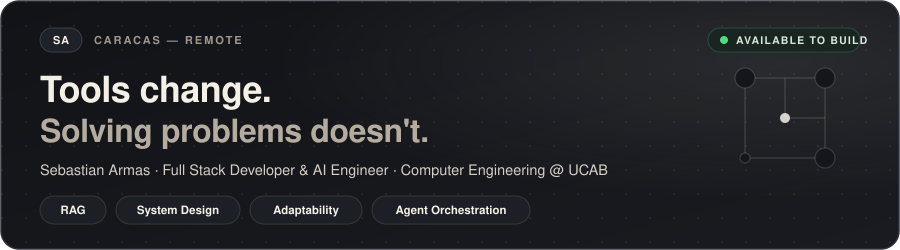

<!-- Adaptive Dark / Light Custom Editorial Hero Banner -->
<picture>
  <source media="(prefers-color-scheme: dark)" srcset="./assets/hero-dark.svg" />
  <source media="(prefers-color-scheme: light)" srcset="./assets/hero-light.svg" />
  
</picture>

  

  
  &nbsp;
  
  &nbsp;
  
  &nbsp;
  

 

## Engineering Philosophy

> *"Frameworks evolve every few months; the ability to understand a complex problem and engineer the right solution does not."*

Grounded in **mathematics, logic, and computer science fundamentals** (`C++`, `Java`, data structures, and system design), I build **Full Stack web systems** and **AI-powered workflows** by choosing the best-fit tools for each specific problem — using AI to automate repetitive tasks so engineering stays focused on architecture, clarity, and impact.

 

## Core Pillars

<table width="100%">
  <tr>
    <td width="50%" valign="top">
      <h3>⬡ System Design</h3>
      
Clean architectures, relational data modeling, scalable APIs, and maintainable Full Stack products engineered to evolve.

    </td>
    <td width="50%" valign="top">
      <h3>⚡ Agent Orchestration</h3>
      
AI-assisted engineering and multi-agent workflows (<code>Claude Code</code>, <code>Antigravity</code>, <code>Codex</code>, <code>Orca</code>, <code>n8n</code>) to ship faster without sacrificing code quality.

    </td>
  </tr>
  <tr>
    <td width="50%" valign="top">
      <h3>🧠 RAG &amp; AI Systems</h3>
      
Retrieval-augmented pipelines, structured LLM outputs, and practical AI integrations built around real operational problems.

    </td>
    <td width="50%" valign="top">
      <h3>🔄 Adaptability</h3>
      
Tech-agnostic mindset, fast onboarding across stacks, and strong collaboration in high-velocity engineering teams.

    </td>
  </tr>
</table>

 

## Featured Projects

<table width="100%">
  <tr>
    <td width="50%" valign="top">
      <h3>📱 <a href="https://github.com/Sebasarmas19/Organizer">Organizer</a></h3>
      
Personal planning &amp; time-management PWA built for iPhone with Web Push (<code>pg_cron</code> + Supabase Edge Functions) and iOS Siri Shortcuts.

      

        <code>Next.js 16</code> · <code>TypeScript</code> · <code>Supabase</code> · <code>Tailwind 4</code>
      

      

        <a href="https://organizer-sigma-one.vercel.app"><strong>↗ Live Demo</strong></a> &nbsp;·&nbsp;
        <a href="https://github.com/Sebasarmas19/Organizer"><strong>Source Code</strong></a>
      

    </td>
    <td width="50%" valign="top">
      <h3>🏠 <a href="https://github.com/Sebasarmas19/Dinow">Dinow</a></h3>
      
Gamified household chores &amp; reminders PWA featuring weekly schedules, coverage bonuses, achievements, and PIN-based audit logs.

      

        <code>TypeScript</code> · <code>Next.js</code> · <code>PWA</code>
      

      

        <a href="https://dinow-ashy.vercel.app"><strong>↗ Live Demo</strong></a> &nbsp;·&nbsp;
        <a href="https://github.com/Sebasarmas19/Dinow"><strong>Source Code</strong></a>
      

    </td>
  </tr>
  <tr>
    <td width="50%" valign="top">
      <h3>🎓 <a href="https://github.com/Sebasarmas19/RateMat">RateMat</a></h3>
      
Independent student platform for professor ratings, curricula, and course discovery built for the UCAB community.

      

        <code>Angular 18</code> · <code>NestJS 10</code> · <code>PostgreSQL</code> · <code>Tailwind</code>
      

      

        <a href="https://github.com/Sebasarmas19/RateMat"><strong>Source Code</strong></a>
      

    </td>
    <td width="50%" valign="top">
      <h3>⚙️ <a href="https://github.com/AnluYaens/nodeaway">Nodeaway</a></h3>
      
Packages complex <code>n8n</code> workflows into simple, form-driven product recipes backed by FastAPI — hiding operational complexity without hiding logic.

      

        <code>Python</code> · <code>FastAPI</code> · <code>n8n</code>
      

      

        <a href="https://github.com/AnluYaens/nodeaway"><strong>Source Code</strong></a>
      

    </td>
  </tr>
  <tr>
    <td width="50%" valign="top">
      <h3>🤖 <a href="https://github.com/Sebasarmas19/Chatbot-Reminder">Chatbot-Reminder</a></h3>
      
AI-powered personal reminder assistant over WhatsApp combining conversational AI with automated scheduling workflows.

      

        <code>TypeScript</code> · <code>n8n</code> · <code>Evolution API</code> · <code>Gemini</code>
      

      

        <a href="https://github.com/Sebasarmas19/Chatbot-Reminder"><strong>Source Code</strong></a>
      

    </td>
    <td width="50%" valign="top">
      <h3>🌤️ <a href="https://github.com/Sebasarmas19/Proyecto_Parcial_Web2">SkyDash-Manager</a></h3>
      
Georeferenced weather analytics and visualization platform built from scratch with zero frameworks.

      

        <code>HTML5</code> · <code>CSS3</code> · <code>Vanilla JavaScript</code>
      

      

        <a href="https://github.com/Sebasarmas19/Proyecto_Parcial_Web2"><strong>Source Code</strong></a>
      

    </td>
  </tr>
</table>

 

## Tech Ecosystem

    
    
  

 

## Activity & Consistency

  

 

  

