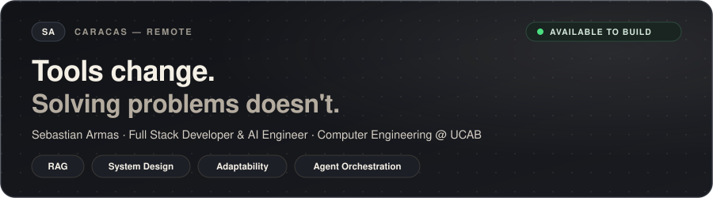
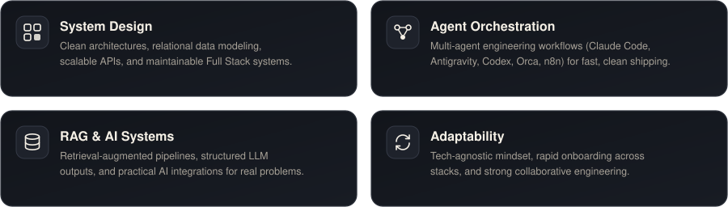
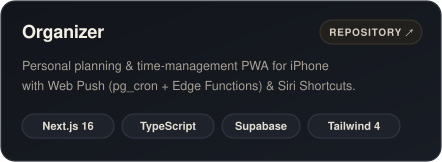
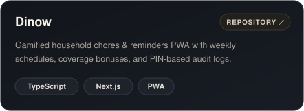
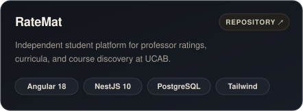
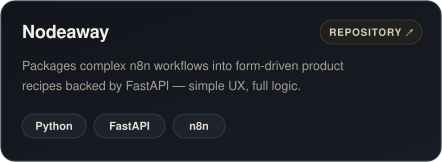
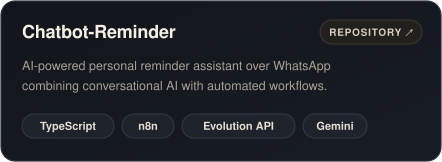
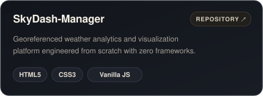

<!-- Adaptive Dark / Light Custom Editorial Hero Banner -->
<picture>
  <source media="(prefers-color-scheme: dark)" srcset="./assets/hero-dark-v2.svg" />
  <source media="(prefers-color-scheme: light)" srcset="./assets/hero-light-v2.svg" />
  
</picture>

  

  
  &nbsp;
  
  &nbsp;
  
  &nbsp;
  

 

## Engineering Philosophy

> *"Frameworks evolve every few months; the ability to understand a complex problem and engineer the right solution does not."*

Grounded in **mathematics, logic, and computer science fundamentals** (`C++`, `Java`, data structures, and system design), I build **Full Stack web systems** and **AI-powered workflows** by choosing the best-fit tools for each specific problem — using AI to automate repetitive tasks so engineering stays focused on architecture, clarity, and impact.

 

## Core Pillars

  <picture>
    <source media="(prefers-color-scheme: dark)" srcset="./assets/pillars-dark-v1.svg" />
    <source media="(prefers-color-scheme: light)" srcset="./assets/pillars-light-v1.svg" />
    
  </picture>

 

## Featured Projects

  <a href="https://organizer-sigma-one.vercel.app"><picture><source media="(prefers-color-scheme: dark)" srcset="./assets/project-organizer-dark-v2.svg" /><source media="(prefers-color-scheme: light)" srcset="./assets/project-organizer-light-v2.svg" /></picture></a>
  &nbsp;
  <a href="https://dinow-ashy.vercel.app"><picture><source media="(prefers-color-scheme: dark)" srcset="./assets/project-dinow-dark-v2.svg" /><source media="(prefers-color-scheme: light)" srcset="./assets/project-dinow-light-v2.svg" /></picture></a>

  <a href="https://github.com/Sebasarmas19/RateMat"><picture><source media="(prefers-color-scheme: dark)" srcset="./assets/project-ratemat-dark-v1.svg" /><source media="(prefers-color-scheme: light)" srcset="./assets/project-ratemat-light-v1.svg" /></picture></a>
  &nbsp;
  <a href="https://github.com/AnluYaens/nodeaway"><picture><source media="(prefers-color-scheme: dark)" srcset="./assets/project-nodeaway-dark-v1.svg" /><source media="(prefers-color-scheme: light)" srcset="./assets/project-nodeaway-light-v1.svg" /></picture></a>

  <a href="https://github.com/Sebasarmas19/Chatbot-Reminder"><picture><source media="(prefers-color-scheme: dark)" srcset="./assets/project-chatbot-dark-v1.svg" /><source media="(prefers-color-scheme: light)" srcset="./assets/project-chatbot-light-v1.svg" /></picture></a>
  &nbsp;
  <a href="https://github.com/Sebasarmas19/Proyecto_Parcial_Web2"><picture><source media="(prefers-color-scheme: dark)" srcset="./assets/project-skydash-dark-v1.svg" /><source media="(prefers-color-scheme: light)" srcset="./assets/project-skydash-light-v1.svg" /></picture></a>

 

## Tech Ecosystem

    
    
  

 

## Activity & Consistency

  

 

  

